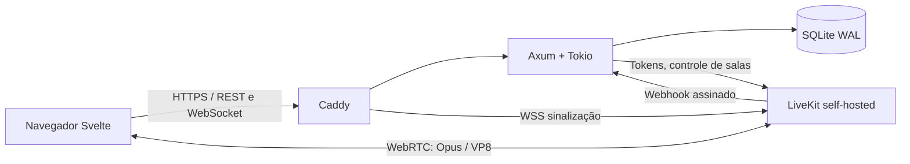

# Subdisc

Comunicação privada para pequenos grupos: chat persistente, salas de voz permanentes, webcam e tela ao vivo. Interface em português brasileiro, dark-first, sem contas externas, telemetria obrigatória ou serviços de nuvem. Código original sob licença MIT.

**Estado: MVP implementado, validado nativamente e em execução local via Docker Compose.** Dois navegadores passaram pelo fluxo real de chat e WebRTC com LiveKit nativo. No Compose, app, LiveKit e Caddy estão saudáveis; a página, a API e a sinalização responderam HTTP 200. O E2E de mídia pelo Docker, internet, TURN/TLS, dispositivos físicos e ARM64 ainda precisam da validação descrita em [docs/testing.md](docs/testing.md).

## Executar com Docker

Requer Linux, Docker Engine ativo e Docker Compose moderno (2.23.1 ou superior, com `configs.content`).

```bash
cp .env.example .env
docker compose up --build -d
docker compose ps
```

Abra **http://localhost:8080**. A configuração de exemplo é exclusivamente para localhost; o navegador permite microfone/câmera nesse contexto. Acesso por IP de outra máquina exige HTTPS.

1. Na primeira tela, crie o administrador: usuário de 3–32 letras ASCII, números, `_` ou `-`, senha com pelo menos 12 caracteres e a `SETUP_KEY` do `.env`.
2. Clique em **Convidar amigos → Gerar convite**. Cada link permite um cadastro e expira em 24 horas. A API permite até 7 dias.
3. O amigo abre o link, escolhe usuário e senha. Não existe cadastro sem convite.
4. Clique em **sala de estar**, permita o microfone e comece a falar. Câmera e compartilhamento são opcionais. Os controles ficam disponíveis enquanto você navega pelo chat.
5. Administradores podem criar, renomear e excluir canais no mesmo painel. Excluir um canal também exclui seu histórico; a interface pede confirmação.

**Para acesso externo, configure produção antes de iniciar.** Consulte [domínio, HTTPS, firewall, NAT e TURN](docs/deployment.md). Não publique o `.env.example` na internet.

## Arquitetura



Um processo Rust cuida de contas, autorização, convites, sessões, canais e mensagens. O mesmo binário serve o frontend compilado. SQLite mantém o histórico; presença fica em memória e usa eventos, sem polling contínuo de chat. O SFU recebe e encaminha mídia diretamente, sem passar pelo Rust, sem transcoding e sem gravação.

As salas permanentes são registros no banco. As salas internas do SFU podem desaparecer quando vazias e são recriadas com o mesmo identificador na próxima entrada. Todos os membros têm acesso aos canais da instância; apenas administradores gerenciam convites e canais.

Foi escolhida **uma chamada por conta**, inclusive entre sessões/dispositivos. Web Locks evitam competição entre abas; o backend serializa a emissão de credenciais e o webhook rejeita identidades antigas. Ao reiniciar o backend, as chamadas abertas devem ser reabertas: o cliente recebe `voice_reset` após reconectar, e a próxima entrada remove identidades órfãs no SFU. Uma tentativa que falhou antes de conectar pode reservar a chamada por até 75 segundos.

O LiveKit é dedicado à instância e suas credenciais são exclusivamente do servidor. Tokens de mídia duram 60 segundos para entrada e concedem apenas a sala e fontes de mídia permitidas, sem administração ou publicação de dados. O SDK cuida de ICE, DTLS/SRTP, reconexão, Opus, vídeo VP8, simulcast e adaptação de assinatura. Veja a [documentação oficial dos tokens](https://docs.livekit.io/home/server/generating-tokens) e o [SDK Rust oficial](https://github.com/livekit/rust-sdks).

## Repositório

```text
backend/
  Cargo.toml, Cargo.lock        Dependências Rust fixadas no lockfile
  migrations/                  Schema SQLite versionado
  src/auth/                    Argon2id, sessões e convites
  src/channels/                CRUD e chat paginado
  src/media/                   Grants, exclusividade e webhook LiveKit
  src/websocket/               Eventos versionados, heartbeat e presença
  src/api/, db/, config.rs      Estado, persistência e configuração
  tests/api.rs                 Integração HTTP, WebSocket e segurança
frontend/
  src/pages/Auth.svelte        Instalação, login e cadastro
  src/App.svelte               Navegação, chat e administração
  src/components/              Chamada, áudio persistente e dispositivos
  src/stores/media.ts          Ciclo de vida real do LiveKit
  src/lib/                     API, tipos, mensagens e textos compartilhados
  tests/                       Vitest e E2E Playwright
infrastructure/                 Caddy, LiveKit e opção TURN/TLS
scripts/                        Desenvolvimento, configuração e backup
Dockerfile, docker-compose.yml  Produção e volumes persistentes
.env.example                    Desenvolvimento local
```

## Desenvolvimento sem Docker

Ferramentas verificadas: Rust **1.99.1**, edição **2024**; Node **24.13.1**; Svelte **5.57.2**; Vite **8.3.4**; LiveKit JS **2.23.0**, API Rust **0.9.0**, servidor **1.13.10**; Axum **0.8.9**, SQLx **0.8.6**. Os lockfiles registram as versões exatas. As dependências usam APIs estáveis; atualizar SQLx ou Argon2 para outra versão maior exige revisão.

```bash
cp .env.example .env
npm --prefix frontend ci
cargo build --manifest-path backend/Cargo.toml
# Baixe o livekit-server 1.13.10 oficial para sua arquitetura:
# https://github.com/livekit/livekit/releases/tag/v1.13.10
LIVEKIT_BINARY=/caminho/livekit-server ./scripts/dev.sh
```

Abra **http://localhost:5173**. `dev.sh` inicia Vite, Rust e LiveKit, encerra seus processos filhos ao sair e usa SQLite em `data/`. Se o Rust tiver sido instalado em `.tools/` durante esta sessão, use `./scripts/cargo.sh` no lugar de `cargo`. A pasta `.tools/` não faz parte da distribuição.

## Segurança e limites

- Argon2id com sal aleatório; hashing fora do executor assíncrono, limitado a quatro operações simultâneas.
- Sessões aleatórias de 256 bits; apenas SHA-256 do segredo no banco. Expiração após 30 dias sem uso (o uso renova a sessão), cookies HttpOnly e SameSite=Strict; Secure obrigatório em produção. Logout revoga a sessão e fecha seus WebSockets.
- Convites aleatórios de 256 bits, armazenados como hash; consumo atômico com `BEGIN IMMEDIATE`. A primeira conta também é criada em transação exclusiva e exige a chave de instalação.
- Verificação exata de Origin em mutações e no upgrade WebSocket. Sem CORS liberado. Webhooks usam assinatura do SDK e hash do corpo bruto.
- Queries parametrizadas, limites de corpo e mensagens, escape do Svelte, CSP, bloqueio de frames e headers de cache restritivos.
- Limites por minuto em memória: 60 tentativas de autenticação por endereço de conexão e 10 por nome; 10 convites por administrador; 60 mensagens, 15 entradas em chamada e 120 eventos de estado por usuário. Há no máximo 8 WebSockets por conta.
- O backend não confia em `X-Forwarded-For`. Atrás do Caddy, o limite por endereço é compartilhado pela instância; o limite por nome continua individual. Estado do limitador reinicia com o processo.
- Senhas, cookies, tokens e chaves não são escritos nos logs da aplicação. Não habilite dumps de corpos/headers no proxy.
- O SDK informa os estados de mídia do cliente; o webhook confirma entrada/saída. Os eventos de microfone/câmera são indicadores de interface, não uma fronteira de autorização.
- O servidor deve ficar atrás do Caddy. Não exponha o banco, porta HTTP Rust ou API administrativa do Caddy.

Não há criptografia ponta a ponta personalizada. WebRTC protege o transporte; o administrador da infraestrutura é parte da confiança. Não há upload ou armazenamento de mídia.

## Testes e operação

```bash
./scripts/cargo.sh test --manifest-path backend/Cargo.toml
./scripts/cargo.sh clippy --manifest-path backend/Cargo.toml --all-targets -- -D warnings
npm --prefix frontend run check
npm --prefix frontend test
npm --prefix frontend run build
cd frontend
npx playwright install chromium
LIVEKIT_BINARY=/caminho/livekit-server npm run test:e2e
```

O E2E cria banco temporário, inicia backend e LiveKit reais em portas locais e usa dois contextos Chromium com microfone/câmera simulados. Nenhuma API de produção usa mocks. Instruções detalhadas, resultados reais e pendências estão em [docs/testing.md](docs/testing.md); contrato HTTP e eventos em [docs/api.md](docs/api.md).

Backup com breve interrupção do backend: `./scripts/backup.sh`. Atualização, restauração e medição de consumo: [docs/deployment.md](docs/deployment.md).

Próximas melhorias: executar a matriz de redes/dispositivos, validar mídia via Compose e a execução ARM64, adicionar recuperação administrativa de senha e moderação básica, ampliar testes de acessibilidade e extrair todos os textos restantes para os catálogos de idioma.
