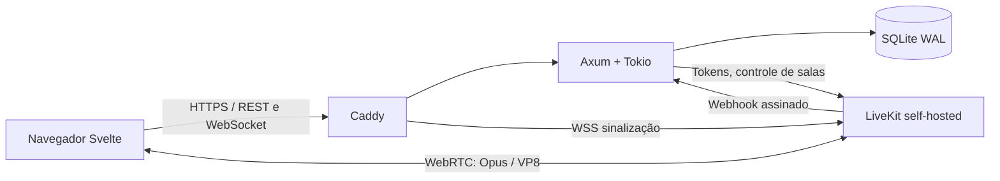

# kledisc — servidor e front web

Chat, contas, administração, voz, câmera e compartilhamento de tela. Este repositório contém o backend Rust, o site Svelte e a configuração do LiveKit/Caddy. O cliente desktop está em [sub-disc-client](https://github.com/GuilhermeGMV/sub-disc-client).

## Rodar depois de configurar

Execute na **raiz deste repositório**. Escolha uma instalação: Docker ou nativa; não inicie as duas nas mesmas portas.

### Linux com Docker Compose

Com `.env`, DNS e firewall configurados conforme as seções abaixo:

```bash
docker compose up --build -d
docker compose ps
docker compose logs --tail=100 app livekit caddy
```

Abra o domínio de `APP_ORIGIN`. Para parar sem apagar os dados: `docker compose stop`. Para retomar sem recompilar: `docker compose up -d`.

### Windows nativo (PowerShell)

Com o frontend/backend já compilados, `livekit-server.exe` e `caddy.exe` no `PATH`, `.env` preenchido e os dois arquivos de configuração nativa preparados abaixo:

```powershell
# Na raiz do sub-disc, uma única vez por inicialização.
# Formato deste .env: NOME=valor, sem aspas, sem "export" e sem ${interpolacao}.
Get-Content .env | ForEach-Object {
    $line = $_.Trim()
    if ($line -and !$line.StartsWith('#')) {
        $pair = $line -split '=', 2
        if ($pair.Count -ne 2) { throw "Linha inválida no .env" }
        [Environment]::SetEnvironmentVariable($pair[0].Trim(), $pair[1], 'Process')
    }
}
$env:LIVEKIT_KEYS = "$($env:LIVEKIT_API_KEY): $($env:LIVEKIT_API_SECRET)"
New-Item -ItemType Directory -Force data, logs | Out-Null
Start-Process livekit-server.exe -ArgumentList '--config infrastructure/livekit.production.yaml' -WorkingDirectory $PWD -WindowStyle Hidden -RedirectStandardOutput logs/livekit.out.log -RedirectStandardError logs/livekit.err.log
Start-Process caddy.exe -ArgumentList 'run --config infrastructure/Caddyfile.native --adapter caddyfile' -WorkingDirectory $PWD -WindowStyle Hidden -RedirectStandardOutput logs/caddy.out.log -RedirectStandardError logs/caddy.err.log
.\backend\target\release\subdisc.exe
```

O backend permanece nesse terminal. Os dois processos iniciados em segundo plano continuam até serem encerrados; não são serviços instalados no Windows. Para encerrar a instalação, use `Ctrl+C` no backend e encerre **os processos LiveKit/Caddy desta instalação**. Se já houver serviços rodando, use o gerenciador deles em vez de iniciar cópias. Erro `10048` indica uma porta já ocupada.

### Linux nativo

Com os mesmos arquivos de configuração nativa e os binários já instalados, abra três terminais na raiz. Importe o `.env` em **cada terminal**:

```bash
set -a
. ./.env
set +a
export LIVEKIT_KEYS="$LIVEKIT_API_KEY: $LIVEKIT_API_SECRET"
mkdir -p data
```

Depois rode um comando em cada terminal:

```bash
# Terminal 1
livekit-server --config infrastructure/livekit.production.yaml
# Terminal 2 (Caddy precisa de permissão para escutar 80/443)
caddy run --config infrastructure/Caddyfile.native --adapter caddyfile
# Terminal 3
./backend/target/release/subdisc
```

Para execução contínua, configure serviços do sistema com usuário, diretório de trabalho e ambiente corretos. O `.env` contém segredos: não o publique nem cole seu conteúdo nos logs.

## O que precisa estar instalado

| Modo | Requisitos |
|---|---|
| Docker no Linux | Git, Docker Engine ativo, Docker Compose 2.23.1 ou superior (`configs.content`), Python 3 para gerar o `.env` |
| Nativo | Rust com edição 2024 (o Dockerfile fixa 1.99.1), Node.js 24 + npm, LiveKit Server 1.13.10 e Caddy 2 |
| Compilação no Windows | Rust MSVC e Visual Studio Build Tools com **Desenvolvimento para desktop com C++** e Windows SDK |
| Compilação no Linux Debian/Ubuntu | Compilador C/C++, `pkg-config` e headers OpenSSL; por exemplo `sudo apt-get install build-essential pkg-config libssl-dev` |

Obtenha o [LiveKit Server da versão usada no projeto](https://github.com/livekit/livekit/releases/tag/v1.13.10) para seu sistema/arquitetura e o [Caddy](https://caddyserver.com/download). Para os comandos nativos acima, coloque ambos no `PATH` ou substitua seus nomes pelos caminhos completos.

## Domínio, rede e portas

Use dois nomes que apontem para o **IP público do servidor**:

- `chat.exemplo.com`: site, API e WebSocket do chat.
- `rtc.exemplo.com`: sinalização de voz/vídeo do LiveKit.

Crie registros DNS `A` para o IPv4 público. Só publique `AAAA` se IPv6 e firewall também estiverem funcionando. Comece com DNS direto, sem proxy HTTP intermediário. O Caddy obtém e renova os certificados HTTPS dos dois nomes.

| Porta de entrada | Uso |
|---|---|
| TCP 80 | Certificado e redirecionamento para HTTPS |
| TCP 443 | Site HTTPS e sinalização WSS |
| UDP 443 | HTTP/3 do Caddy, opcional |
| UDP 7882 | Mídia WebRTC principal |
| TCP 7881 | Alternativa ICE/TCP |
| UDP 3478 | Somente se TURN/UDP estiver habilitado |
| TCP 5349 | Somente se TURN/TLS estiver configurado |

Libere as portas no firewall do sistema e do provedor. Atrás de roteador, fixe/reserve o IP local do servidor e encaminhe as portas para ele, com o protocolo correto. **O vídeo/áudio em UDP 7882 não passa pelo proxy HTTPS.** Não é necessário abrir também a faixa 50000–60000 com a configuração mux deste projeto.

Não encaminhe as portas internas `3000` (backend), `7880` (API/sinalização sem TLS) ou `2019` (administração do Caddy) à internet. No Compose, as publicações `8080`/`7880` atendem ao modo localhost; remova essas duas entradas de `services.caddy.ports` se a instalação for exclusivamente de produção.

Se o provedor usa **CGNAT**, encaminhar portas no roteador não basta: você precisa de um IP público alcançável ou de uma VPN/rede que transporte a mídia e seja acessível aos participantes. Um túnel apenas HTTP não resolve WebRTC. Teste pelo celular fora do Wi-Fi, além da rede local; alguns roteadores não oferecem NAT hairpin.

Com IP dinâmico, atualize tanto o DNS quanto `LIVEKIT_NODE_IP` e reinicie/recrie o LiveKit. O perfil DuckDNS atualiza somente o DNS; instruções de DuckDNS e TURN/TLS estão em [docs/deployment.md](docs/deployment.md).

## `.env` de produção

### Gerar para Docker

Em uma instalação nova, sem `.env` existente:

```bash
python3 scripts/configure.py \
  --domain chat.exemplo.com \
  --media-domain rtc.exemplo.com \
  --public-ip 203.0.113.10
```

Substitua os domínios e o IP de documentação pelos reais. O script gera segredos aleatórios e se recusa a sobrescrever `.env`. No Windows, use `python` e escreva o comando em uma linha. Não use os segredos de `.env.example` em produção.

| Variável | Valor/objetivo |
|---|---|
| `APP_ENV` | `production`; `development` somente para testes locais HTTP |
| `APP_ORIGIN` | `https://chat.exemplo.com`, sem barra final; deve coincidir com a origem usada no navegador |
| `APP_ADDRESS` | `chat.exemplo.com`, sem protocolo, usado pelo Caddy do Compose |
| `MEDIA_ADDRESS` | `rtc.exemplo.com`, usado pelo Caddy do Compose |
| `SETUP_KEY` | Segredo para criar o primeiro administrador, pelo menos 16 caracteres |
| `LIVEKIT_URL` | `wss://rtc.exemplo.com`, endereço público entregue aos clientes |
| `LIVEKIT_API_KEY` | Identificador compartilhado por backend, LiveKit e webhook, por exemplo `subdisc` |
| `LIVEKIT_API_SECRET` | Segredo compartilhado por backend e LiveKit, pelo menos 32 caracteres em produção |
| `LIVEKIT_NODE_IP` | IPv4 público alcançável anunciado aos clientes de mídia |
| `LIVEKIT_LOOPBACK` | `false` em produção |
| `TURN_ENABLED` / `TURN_DOMAIN` | `false` / vazio inicialmente; consulte o guia para habilitar TURN |

### Acrescentar para execução nativa

Acrescente ao `.env` gerado:

```dotenv
BIND=127.0.0.1:3000
DATABASE_URL=sqlite://data/subdisc.db
STATIC_DIR=frontend/dist
LIVEKIT_INTERNAL_URL=http://127.0.0.1:7880
RUST_LOG=subdisc=info,tower_http=info
```

Execute sempre na raiz: banco e arquivos estáticos usam caminhos relativos. `LIVEKIT_INTERNAL_URL` é a API de controle acessada pelo backend; não deixe a variável vazia e não confunda com `LIVEKIT_URL`, que é pública.

**O executável Rust não lê `.env` automaticamente.** Use a importação de ambiente mostrada no topo. Variáveis alteradas precisam ser recarregadas e os processos afetados reiniciados. O Docker Compose lê `.env` e repassa as variáveis previstas no YAML; nele, banco, arquivos estáticos e URL interna já são definidos como `/data/subdisc.db`, `/app/public` e `http://livekit:7880`. Acrescentar `BIND` no `.env` não altera o Compose sem ajustar seu YAML.

## LiveKit e Caddy nativos

O arquivo `infrastructure/livekit.yaml` existente é **somente local**. Para internet, crie `infrastructure/livekit.production.yaml` com o IPv4 público real:

```yaml
port: 7880
bind_addresses: [0.0.0.0]
rtc:
  tcp_port: 7881
  udp_port: 7882
  node_ip: 203.0.113.10
  use_external_ip: false
  enable_loopback_candidate: false
webhook:
  api_key: subdisc
  urls: [http://127.0.0.1:3000/api/livekit/webhook]
room:
  max_participants: 20
  empty_timeout: 300
logging:
  level: info
  json: true
```

Ajuste `webhook.api_key` para o mesmo `LIVEKIT_API_KEY` do `.env`. As chaves são passadas via `LIVEKIT_KEYS` nos comandos do topo. Este YAML nativo **não interpola** `LIVEKIT_NODE_IP` do `.env`: mantenha `rtc.node_ip` atualizado no próprio arquivo. Como os listeners são expostos nas interfaces do host, bloqueie acesso externo à porta `7880` pelo firewall.

Crie `infrastructure/Caddyfile.native`, substituindo os dois domínios:

```caddyfile
chat.exemplo.com {
    encode zstd gzip
    reverse_proxy 127.0.0.1:3000
}
rtc.exemplo.com {
    reverse_proxy 127.0.0.1:7880
}
```

O Caddyfile original usa nomes de serviços Docker (`app`, `livekit`); não serve diretamente para processos nativos. Para validar o arquivo nativo:

```bash
caddy validate --config infrastructure/Caddyfile.native --adapter caddyfile
```

No Linux, execute o Caddy como serviço com permissão para escutar 80/443 ou configure as capabilities apropriadas. Mantenha seu diretório de dados persistente para preservar certificados.

## Compilar o servidor e o site (modo nativo)

Na raiz, no PowerShell ou Bash:

```bash
npm --prefix frontend ci
npm --prefix frontend run check
npm --prefix frontend run build
cargo build --release --locked --manifest-path backend/Cargo.toml
```

Verifique que cada comando terminou com sucesso. Resultados:

- Front: `frontend/dist/`, incluindo ícone e assets; precisa acompanhar o backend.
- Windows: `backend/target/release/subdisc.exe`.
- Linux: `backend/target/release/subdisc`.

O nome interno do executável/banco continua `subdisc`; a marca exibida é **kledisc**. O backend aplica migrations na inicialização. Crie `data/` antes de iniciar. No Docker, `docker compose up --build -d` compila os dois componentes e inclui o frontend na imagem.

## Primeiro acesso e verificação

1. Abra `https://chat.exemplo.com` e use a `SETUP_KEY` do seu `.env` para criar o primeiro administrador. Usuário: 3–32 caracteres ASCII (letras, números, `_`, `-`); senha: pelo menos 12 caracteres.
2. Use o painel de administração para gerenciar usuários, permissões `admin`/`member` e canais, ou gere convites para cadastro. Cada novo link vale por 24 horas desde a criação e aceita até 5 cadastros; o uso não renova o prazo.
3. Entre em uma sala de voz e teste microfone, câmera e tela com outro participante, de preferência em outra rede.
4. No cliente nativo, informe o domínio do **chat**, não o domínio `rtc`.

```bash
curl -f https://chat.exemplo.com/api/health
```

No Windows: `Invoke-WebRequest https://chat.exemplo.com/api/health`. HTTP 200 confirma o backend; não comprova conectividade de mídia. Câmera/microfone na web precisam de HTTPS, exceto em `localhost`.

| Sintoma | Verificação |
|---|---|
| Caddy responde 502 | Backend não está ouvindo em `127.0.0.1:3000`, morreu ou o proxy aponta para outra porta |
| `10048` / address already in use | Já existe processo na porta; identifique-o antes de iniciar outra instância |
| Site funciona, chamada não | DNS `rtc`, WSS, credenciais, webhook, `rtc.node_ip`, UDP 7882 e TCP 7881 |
| Certificado não é emitido | DNS público, portas 80/443, firewall, CGNAT e outros serviços ocupando as portas |
| Login/cookie/origin falha | `APP_ORIGIN` deve corresponder exatamente ao domínio HTTPS acessado |
| Câmera web indisponível por IP local | Use um domínio HTTPS e dê permissão no navegador |

## Teste local e desenvolvimento

Para testar **somente na própria máquina**, o exemplo usa HTTP e segredos de desenvolvimento:

```bash
cp .env.example .env  # apenas se ainda não houver .env configurado
# Docker:
docker compose up --build -d
```

Abra `http://localhost:8080`. Não reutilize esse `.env` para publicar na internet.

Para desenvolvimento Linux sem Docker, com `.env` de desenvolvimento:

```bash
npm --prefix frontend ci
LIVEKIT_BINARY=/caminho/livekit-server bash scripts/dev.sh
```

Abra `http://localhost:5173`. O script inicia Rust, Vite e LiveKit, carrega o `.env` e ajusta as URLs locais; encerra seus processos filhos ao sair.

## Atualizar e fazer backup

No Docker:

```bash
bash scripts/backup.sh
# Atualize o código, sem descartar mudanças locais, e então:
docker compose up --build -d
```

Não use `docker compose down -v` para atualizar: ele apaga volumes. Preserve `app_data` (SQLite) e `caddy_data` (certificados), além do `.env` em local privado.

Na instalação nativa, pare o backend antes de copiar **toda a pasta `data/`**, incluindo WAL/SHM, para um backup consistente. Guarde `.env`, configurações nativas e os dados do Caddy. Compile o novo código, substitua o binário e `frontend/dist`, recarregue o ambiente e inicie novamente. Alterações somente no frontend não exigem reiniciar o backend; alterações de ambiente exigem reinício. Após reiniciar o backend, entre novamente nas chamadas.

Restauração, TURN/TLS, DuckDNS e diagnóstico detalhado: [docs/deployment.md](docs/deployment.md). Contrato da API: [docs/api.md](docs/api.md).

## Arquitetura



Um processo Rust cuida de contas, autorização, convites, sessões, canais e mensagens. O mesmo binário serve o frontend compilado. SQLite mantém o histórico; presença fica em memória e usa eventos, sem polling contínuo de chat. O SFU recebe e encaminha mídia diretamente, sem passar pelo Rust, sem transcoding e sem gravação.

As salas permanentes são registros no banco. As salas internas do SFU podem desaparecer quando vazias e são recriadas com o mesmo identificador na próxima entrada. Todos os membros têm acesso aos canais da instância; apenas administradores gerenciam convites e canais.

Foi escolhida **uma chamada por conta**, inclusive entre sessões/dispositivos. Web Locks evitam competição entre abas; o backend serializa a emissão de credenciais e o webhook rejeita identidades antigas. Ao reiniciar o backend, as chamadas abertas devem ser reabertas: o cliente recebe `voice_reset` após reconectar, e a próxima entrada remove identidades órfãs no SFU. Uma tentativa que falhou antes de conectar pode reservar a chamada por até 75 segundos.

O LiveKit é dedicado à instância e suas credenciais são exclusivamente do servidor. Tokens de mídia duram 60 segundos para entrada e concedem apenas a sala e fontes de mídia permitidas, sem administração ou publicação de dados. O SDK cuida de ICE, DTLS/SRTP, reconexão, Opus, vídeo VP8, simulcast e adaptação de assinatura. Veja a [documentação oficial dos tokens](https://docs.livekit.io/home/server/generating-tokens) e o [SDK Rust oficial](https://github.com/livekit/rust-sdks).

## Repositório

```text
backend/
  Cargo.toml, Cargo.lock        Dependências Rust fixadas no lockfile
  migrations/                  Schema SQLite versionado
  src/auth/                    Argon2id, sessões e convites
  src/channels/                CRUD e chat paginado
  src/media/                   Grants, exclusividade e webhook LiveKit
  src/websocket/               Eventos versionados, heartbeat e presença
  src/api/, db/, config.rs      Estado, persistência e configuração
  tests/api.rs                 Integração HTTP, WebSocket e segurança
frontend/
  src/pages/Auth.svelte        Instalação, login e cadastro
  src/App.svelte               Navegação, chat e administração
  src/components/              Chamada, áudio persistente e dispositivos
  src/stores/media.ts          Ciclo de vida real do LiveKit
  src/lib/                     API, tipos, mensagens e textos compartilhados
  tests/                       Vitest e E2E Playwright
infrastructure/                 Caddy, LiveKit e opção TURN/TLS
scripts/                        Desenvolvimento, configuração e backup
Dockerfile, docker-compose.yml  Produção e volumes persistentes
.env.example                    Desenvolvimento local
```

## Segurança e limites

- Argon2id com sal aleatório; hashing fora do executor assíncrono, limitado a quatro operações simultâneas.
- Sessões aleatórias de 256 bits; apenas SHA-256 do segredo no banco. Expiração após 30 dias sem uso (o uso renova a sessão), cookies HttpOnly e SameSite=Strict; Secure obrigatório em produção. Logout revoga a sessão e fecha seus WebSockets.
- Convites aleatórios de 256 bits, armazenados como hash; consumo atômico com `BEGIN IMMEDIATE`. A primeira conta também é criada em transação exclusiva e exige a chave de instalação.
- Verificação exata de Origin em mutações e no upgrade WebSocket. Sem CORS liberado. Webhooks usam assinatura do SDK e hash do corpo bruto.
- Queries parametrizadas, limites de corpo e mensagens, escape do Svelte, CSP, bloqueio de frames e headers de cache restritivos.
- Limites por minuto em memória: 60 tentativas de autenticação por endereço de conexão e 10 por nome; 10 convites por administrador; 60 mensagens, 15 entradas em chamada e 120 eventos de estado por usuário. Há no máximo 8 WebSockets por conta.
- O backend não confia em `X-Forwarded-For`. Atrás do Caddy, o limite por endereço é compartilhado pela instância; o limite por nome continua individual. Estado do limitador reinicia com o processo.
- Senhas, cookies, tokens e chaves não são escritos nos logs da aplicação. Não habilite dumps de corpos/headers no proxy.
- O SDK informa os estados de mídia do cliente; o webhook confirma entrada/saída. Os eventos de microfone/câmera são indicadores de interface, não uma fronteira de autorização.
- O servidor deve ficar atrás do Caddy. Não exponha o banco, porta HTTP Rust ou API administrativa do Caddy.

Não há criptografia ponta a ponta personalizada. WebRTC protege o transporte; o administrador da infraestrutura é parte da confiança. Não há upload ou armazenamento de mídia.

## Testes

```bash
cargo test --locked --manifest-path backend/Cargo.toml
npm --prefix frontend run check
npm --prefix frontend test
npm --prefix frontend run build
```

Os testes de mídia entre navegadores precisam também do LiveKit e Playwright. Consulte [docs/testing.md](docs/testing.md) para a configuração e as limitações; uma suíte local não substitui teste de portas, NAT e dispositivos físicos.
