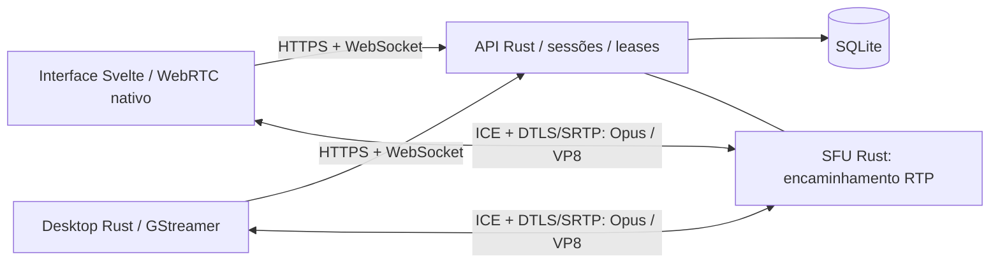

# Subdisc

Servidor privado para chat, voz, câmera e compartilhamento de tela, com API
Rust/Axum, SQLite, frontend Svelte e SFU WebRTC próprio integrado ao backend.
O [cliente desktop Rust](../sub-disc-client) usa a mesma autenticação e salas.
As alterações de mídia estão exclusivamente nas branches `nolivekit`.

## Arquitetura



API e SFU rodam no **mesmo processo Rust**. Não é necessário um servidor de mídia
separado. O SFU usa `webrtc-rs` para ICE, DTLS/SRTP, RTP/RTCP, NACK e relatórios;
Tokio/Axum mantêm o modelo assíncrono existente. Encaminha payloads comprimidos,
com filas limitadas e buffers compartilhados, sem codecs ou transcodificação
no servidor. O desktop usa bindings Rust do GStreamer para dispositivos e mídia.

WebRTC permite interoperar diretamente com navegadores e resolver NAT com ICE.
QUIC/WebTransport exigiria codecs/reprodução próprios no navegador e não substitui
as APIs de mídia existentes. Sinalização usa HTTP autenticado para SDP e WebSocket
para snapshots e controle. Os detalhes estão em [docs/api.md](docs/api.md).

## Recursos preservados

- Instalação privada, administrador, convites, Argon2id, cookies e controle de acesso.
- Canais, histórico paginado, chat e presença em tempo real.
- Até 20 participantes por sala e uma chamada por conta, inclusive entre dispositivos.
- Voz, câmera, tela com áudio opcional, mute/deafen, volumes separados por fonte,
  fullscreen, seleção de dispositivos e qualidade no navegador.
- RNNoise opcional no navegador; processamento de voz e volumes persistentes no desktop.
- Reconexão da sinalização, recuperação de transportes e limpeza de sessões.

Vídeo do navegador usa simulcast com três camadas: cada receptor recebe a camada
adequada ao tamanho exibido e à rede, vídeos fora da tela são pausados e camadas
sem assinantes deixam de ser codificadas. Os presets continuam funcionais.
Consulte [arquitetura e limites de mídia](../sub-disc-client/docs/media.md).

## Desenvolvimento

Requisitos: Rust estável com edição 2024 e Node.js 24. Os lockfiles fixam as
versões; o backend não depende de GStreamer, FFmpeg ou bibliotecas de captura.

```bash
cp .env.example .env
npm --prefix frontend ci
./scripts/dev.sh
```

Abra `http://localhost:5173`. O script inicia somente Rust e Vite e encerra os
filhos ao sair. SQLite fica em `data/`. Use `scripts/cargo.sh` se estiver usando
o toolchain local em `.tools/`. Em execução nativa, API em TCP/3000 e mídia
em UDP/50000–51999; ambas as aplicações recebem a configuração ICE do backend.

## Build e testes

```bash
./scripts/cargo.sh build --release --locked --manifest-path backend/Cargo.toml
./scripts/cargo.sh test --locked --manifest-path backend/Cargo.toml
npm --prefix frontend run check
npm --prefix frontend test
npm --prefix frontend run build
npm --prefix frontend exec -- playwright install chromium
npm --prefix frontend run test:e2e
```

O E2E inicia banco temporário e backend/SFU reais. Exige energia de áudio nos
dois navegadores, vídeo, tela, controles, chat e encerramento de chamada. O teste
adicional de interoperabilidade exige `SUBDISC_NATIVE_BINARY`; instruções no
[cliente desktop](../sub-disc-client/README.md). Compilar isoladamente não valida mídia.
Resultados efetivamente executados: [docs/testing.md](docs/testing.md).

## Produção

```bash
python3 scripts/configure.py --domain conversa.exemplo.com --public-ip SEU_IP_PUBLICO
docker compose up --build -d
```

O gerador não sobrescreve `.env` existente. HTTPS, portas, NAT, TURN opcional,
backup e atualização: [docs/deployment.md](docs/deployment.md). Não faça merge
nas branches principais sem revisão e validação no ambiente de destino.

## Organização

| Caminho | Papel |
|---|---|
| `backend/src/auth`, `channels`, `websocket` | Sessões, canais, chat e eventos existentes |
| `backend/src/media/mod.rs` | Leases, autorização, sinalização e presença de chamadas |
| `backend/src/media/sfu.rs` | WebRTC, fanout RTP, RTCP e ciclo de vida dos transportes |
| `frontend/src/lib/rtc.ts` | Cliente WebRTC nativo e dispositivos |
| `frontend/src/stores/media.ts` | Estado da chamada e controles existentes |
| `frontend/tests/e2e` | Fluxo web e interoperabilidade nativa reais |
| `infrastructure` | Caddy e overlays opcionais de coturn |
